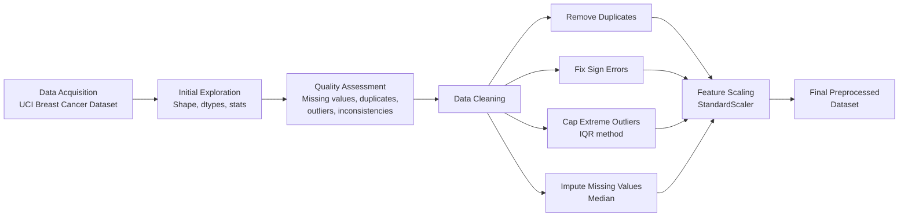

# Breast Cancer Wisconsin — Data Science Internship Project

A step-by-step, real, executed data science project built in Python on the **Breast Cancer Wisconsin (Diagnostic) Dataset** from the UCI Machine Learning Repository (accessed via `sklearn.datasets`). The project is built week by week: each week's work builds directly on the previous one, with the reasoning behind every decision documented.

## 📌 Project Overview

So far the project covers:

- Acquiring a genuine public dataset
- Assessing data quality and cleaning it with justified, documented techniques (Week 1)
- Exploring and visualizing the data (Week 2)
- Finding natural structure with unsupervised clustering (Week 3)
- Building and evaluating a supervised classification model (Week 4)

Since the original UCI dataset is already clean, realistic data quality issues (missing values, duplicate rows, sign errors, extreme outliers) were **deliberately and transparently introduced** into a working copy to simulate real-world messiness — a standard practice for demonstrating a complete cleaning pipeline.

## 🗺️ Project Progress

| Week | Topic | Script | Report | Status |
| ---- | ----- | ------ | ------ | ------ |
| 1 | Data acquisition, cleaning & preprocessing | `data_cleaning_pipeline.py` | `Breast_Cancer_Data_Cleaning_Report.pd.pdf` | ✅ Done |
| 2 | Exploratory data analysis & visualization | `eda_visualization.py` | `Week2_EDA_Visualization_Rajkumar.pdf` | ✅ Done |
| 3 | Unsupervised learning & clustering | `clustering_analysis.py` | `Week3_Clustering_Analysis_Rajkumar.docx` | ✅ Done |
| 4 | Supervised learning model implementation | `supervised_model.py` | `Week4_Supervised_Learning_Model_Rajkumar.docx` | ✅ Done |
| 5 | To be added | — | — | ⏳ Upcoming |
| 6 | To be added | — | — | ⏳ Upcoming |

## 🔄 Week 1 — Cleaning Pipeline



### 🧹 Cleaning Techniques Used

| Issue                       | Technique                    | Reasoning                                                                    |
| --------------------------- | ---------------------------- | ---------------------------------------------------------------------------- |
| Duplicate rows              | `drop_duplicates()`          | Exact duplicates bias statistics/models toward repeated records              |
| Negative "mean area" values | Absolute value               | Physically impossible negative measurement → sign error, not bad data        |
| Extreme outliers            | IQR capping (3x, wide bound) | Targets only clear data-entry errors, preserves genuine biological variation |
| Missing values              | Median imputation            | Robust to skew/outliers, unlike mean                                         |

### 📊 Week 1 — Results

- **569 rows × 31 columns** processed
- 112 missing values → 0
- 6 duplicate rows → 0
- 5 invalid entries corrected
- All numeric features standardized (mean=0, std=1)

## 📈 Week 2 — Key Findings

- Identified top features separating malignant vs benign cases using statistical effect size (Cohen's d) and t-tests
- `worst concave points` and `worst perimeter` showed the strongest separation (Cohen's d > 2.3)
- Found that patients above the median `worst concave points` value are malignant 71.5% of the time, vs only 3.2% below median
- Detected a real anomaly: a visible imputation artifact from Week 1's cleaning step, showing up as an unnatural cluster of points in a scatter plot — a concrete example of how preprocessing choices affect downstream analysis

## 🔍 Week 3 — Key Findings

- Investigated a counterintuitive result: unscaled clustering scored higher on silhouette, but only because it was dominated by one high-variance feature
- Objectively selected k=2 using elbow method + silhouette analysis across k=2 to k=8
- Unsupervised clusters matched real diagnosis labels ~90% of the time (Adjusted Rand Index = 0.65), despite never seeing the labels
- Cross-validated K-Means results against Hierarchical Clustering (Ward linkage) — both methods agreed closely

## 🤖 Week 4 — Key Findings

- Tested 4 engineered features with an ablation test instead of assuming they help — they did not (CV F1 0.9691 → 0.9645), so the original 30 features were kept
- Compared 4 models with 5-fold stratified CV: Logistic Regression (F1 0.964) narrowly beat SVM (0.961), Random Forest (0.949) and Decision Tree (0.885), consistent with the near-linear class separation seen in Weeks 2 and 3
- Tuned Logistic Regression with `GridSearchCV` (best `C = 10`) and evaluated it once on a held-out 114-sample test set, with the scaler fit on training data only to avoid leakage
- **Test results:** Accuracy 97.37% · Precision 97.56% · Recall 95.24% · F1 96.39% · ROC-AUC 0.9848
- Misclassification analysis: 3 errors out of 114 (1 false positive, 2 false negatives). Two of them were *confidently wrong* (predicted malignancy probability of 1.9% and 0.01%), a risk that the headline accuracy hides
- Planned follow-ups: targeted analysis of the confidently-wrong cases and lowering the decision threshold below 0.5 to favour recall

## 🛠️ Tech Stack

- Python 3
- pandas, NumPy
- SciPy (statistical tests, hierarchical clustering)
- scikit-learn (dataset, preprocessing, clustering, classification models, `GridSearchCV`, metrics)
- Matplotlib (visualizations)

## ▶️ How to Run

```bash
pip install pandas numpy scipy scikit-learn matplotlib

python data_cleaning_pipeline.py   # Week 1 — produces the cleaned dataset
python eda_visualization.py        # Week 2
python clustering_analysis.py      # Week 3
python supervised_model.py         # Week 4
```

Weeks 2–4 read `cleaned_dataset.csv`, so run Week 1 first.

## 📁 Output

- Week 1 produces two files:
  - `cleaned_dataset.csv` — cleaned but **unscaled** data, used as the input for Weeks 2, 3 and 4 (each of those steps does its own scaling where needed)
  - `final_preprocessed_dataset.csv` — cleaned and standardized data (mean=0, std=1)
- Week 3 produces `clustered_dataset.csv` (data with K-Means cluster labels) and Week 2 saves its charts as PNG images.
- Week 4 prints the ablation test, model comparison, tuned parameters, held-out test metrics, confusion matrix, ROC-AUC, and the misclassified cases.

## 📁 Project Files

- `data_cleaning_pipeline.py` — Week 1: Data acquisition, cleaning & preprocessing
- `eda_visualization.py` — Week 2: Exploratory data analysis & visualization
- `clustering_analysis.py` — Week 3: Unsupervised learning & clustering (K-Means + Hierarchical)
- `supervised_model.py` — Week 4: Supervised classification, hyperparameter tuning, held-out evaluation and misclassification analysis
- `Breast_Cancer_Data_Cleaning_Report.pd.pdf`, `Week2_EDA_Visualization_Rajkumar.pdf`, `Week3_Clustering_Analysis_Rajkumar.docx`, `Week4_Supervised_Learning_Model_Rajkumar.docx` — written reports for each week
